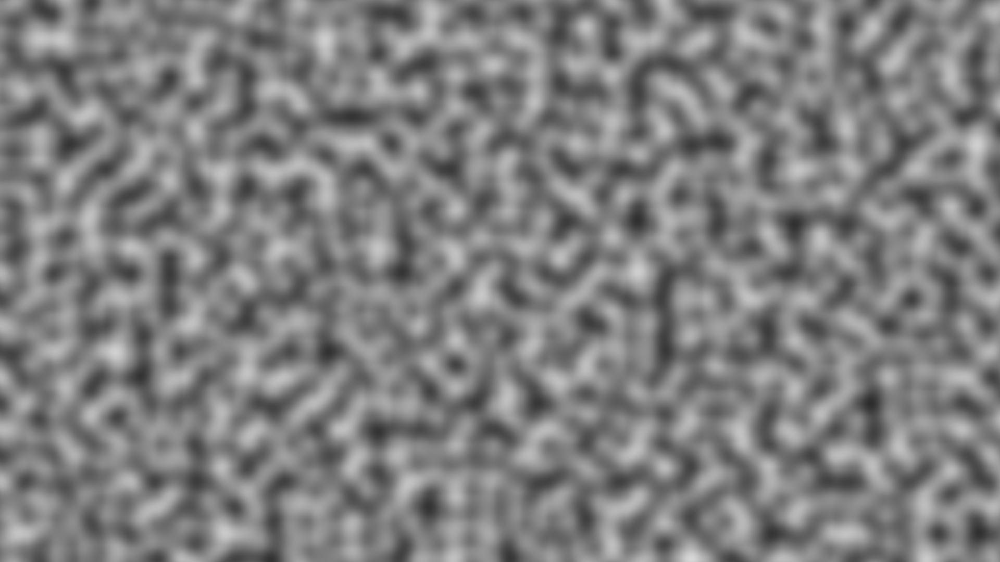
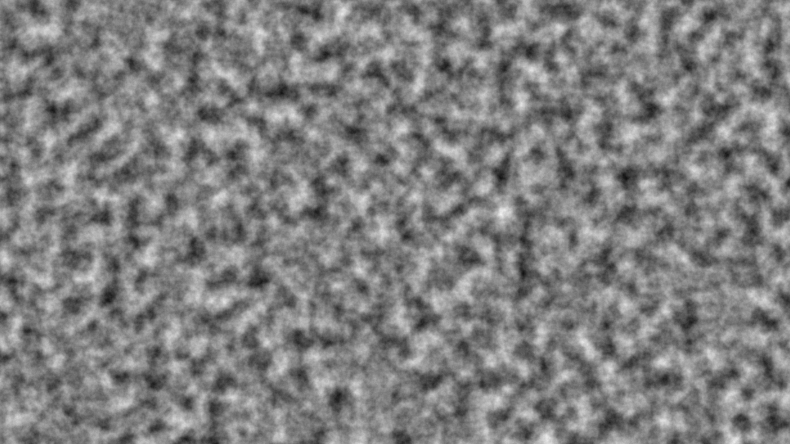

# perlin-noise

Perlin Noise implementation in CPP

Tutorial Video Link: https://youtu.be/kCIaHqb60Cw?si=ci5PX04gFqfMkOvz

- Generates a PGM file.
- Uses ImageMagick to convert PGM files to PNG images.
- Generates maps with 12 octaves.
- Implemented a CUDA version for the GPU.

## Images

| Without Octaves | With 12 Octaves |
|:---:|:---:|
|  |  |

## Hardware used: 
- CPU: Intel Core Ultra 7 265k
- GPU: Nvidia RTX 5070 Ti

## Execution Times

- CPU Execution Time: 2135.2 ms
- GPU Kernel Execution Time: 0.495488 ms

- Speedup: ~4310×

## How to run

Install imagemagick for PGM -> PNG conversions
```bash
sudo apt update
sudo apt install imagemagick
```

Compile and Run the file
```bash
g++ perlin.cpp -o perlin
./perlin
```

Convert the PGM image to PNG
```bash
convert perlin.pgm perlin.png
```

Run the CUDA File
```bash
nvcc perlin_cuda.cu -o perlin_cuda
./perlin_cuda
```

Convert the PGM image to PNG
```bash
convert perlin_cuda.pgm perlin_cuda.png
```

